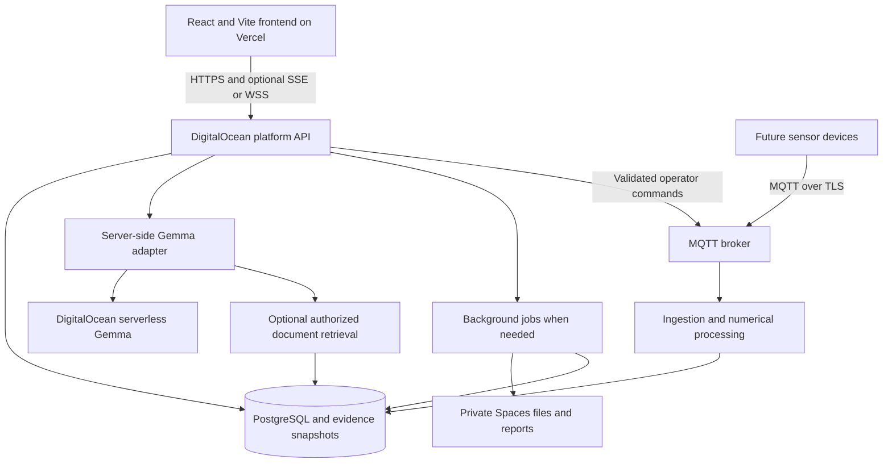

# AquaNereon: Gemma and DigitalOcean integration review

Reviewed 27 October 2026. This is an architecture and scope review of the local checkout, with current official provider documentation checked. Vercel hosting is taken from the user's description; no Vercel or DigitalOcean account/deployment was inspected. All implementation ideas below are proposals. No application integration or cloud resource was created during this review.

**Recommendation:** retain the React/Vite frontend on Vercel. Build the missing platform API and persistence on DigitalOcean, then add Gemma as an evidence-grounded explanation and assistance service. Start with DigitalOcean's serverless Gemma endpoint. Add device ingestion, background processing, document retrieval and dedicated model infrastructure when the corresponding workloads exist.

**What is already implemented**

The repository contains five operator screens, a Three.js junction visualization, a typed REST client, an in-browser platform simulator, MQTT topic/payload contracts, physics/assessment utilities and tests. It does not contain a running backend implementation, database migrations, broker integration, user authentication or model inference.

| Finding | Code evidence | Integration implication |
| --- | --- | --- |
| The API provider selects a browser simulator or HTTP client using `VITE_API_BASE_URL`. | [ApiProvider.tsx](<C:/Users/Ankit kumar/Desktop/DEKSTOP-2/aqua_nereon/src/services/ApiProvider.tsx:31>) | Existing screens can be retained while a DigitalOcean API is implemented. Setting a URL alone does not implement that API. |
| The complete current client contract is typed. | [client.ts](<C:/Users/Ankit kumar/Desktop/DEKSTOP-2/aqua_nereon/src/services/client.ts:36>) and [httpClient.ts](<C:/Users/Ankit kumar/Desktop/DEKSTOP-2/aqua_nereon/src/services/httpClient.ts:103>) | Implement existing endpoint responses first; extend the contract for AI and durable workflows. |
| `AI-01` and `AI-03` are constructed rule/template outputs; suspected-loss confidence includes a fixed `0.54`. | [assessment.ts](<C:/Users/Ankit kumar/Desktop/DEKSTOP-2/aqua_nereon/src/services/assessment.ts:162>) | The present labels do not establish trained anomaly or leak models. Give Gemma its own model/provenance fields. |
| `AI-02` is a simulated diurnal forecast and `backtest_mape` is randomized. | [platformSimulator.ts](<C:/Users/Ankit kumar/Desktop/DEKSTOP-2/aqua_nereon/src/services/platformSimulator.ts:527>) | Production forecasting requires measured history and actual held-out evaluation. Gemma can explain those results. |
| Node assessment is recomputed locally even when HTTP is selected. | [AssessmentPanel](<C:/Users/Ankit kumar/Desktop/DEKSTOP-2/aqua_nereon/src/components/AssessmentPanel/index.tsx:49>) | Introduce a server assessment/snapshot contract so saved events, node explanations and AI commentary refer to the same evidence. |
| REST refreshes every four seconds. A reconnecting WebSocket source exists separately. | [httpClient.ts](<C:/Users/Ankit kumar/Desktop/DEKSTOP-2/aqua_nereon/src/services/httpClient.ts:63>) and [LiveSensorSource.ts](<C:/Users/Ankit kumar/Desktop/DEKSTOP-2/aqua_nereon/src/viz/data/LiveSensorSource.ts:156>) | Polling is sufficient for an initial backend. Live push needs explicit server and client wiring. |
| The embedded visualization currently consumes signatures through `LiveSensorSource`. | [JunctionPreview](<C:/Users/Ankit kumar/Desktop/DEKSTOP-2/aqua_nereon/src/components/JunctionPreview/index.tsx:43>) | Merely configuring a backend URL does not activate `WebSocketFlowSource`. |
| Event status changes send the full event back through `postEvent` in HTTP mode. | [Events](<C:/Users/Ankit kumar/Desktop/DEKSTOP-2/aqua_nereon/src/pages/Events/index.tsx:54>) | Add an explicit authorized status-transition route; protect stored evidence from browser overwrites. |
| Event history and recommendations are in memory, and intervention/verification lifecycle progression is simulated. | [platformSimulator.ts](<C:/Users/Ankit kumar/Desktop/DEKSTOP-2/aqua_nereon/src/services/platformSimulator.ts:88>) and [lifecycle logic](<C:/Users/Ankit kumar/Desktop/DEKSTOP-2/aqua_nereon/src/services/platformSimulator.ts:391>) | Persistent incidents, operator actions and measured verification must precede trustworthy historical reporting. |
| Reports export JSON and query a limited event collection. | [Reports](<C:/Users/Ankit kumar/Desktop/DEKSTOP-2/aqua_nereon/src/pages/Reports/index.tsx:29>) | Add server date filtering, pagination, saved report jobs and export files for full historical reports. |

**Gemma scope map**

P1 means the first AI release, P2 means the next useful increment after durable backend data exists, and P3 means an extension needing additional data or interfaces. These are implementation priorities, not deployment commitments.

| # | Scope and operator example | Existing integration location | What must be added | Priority |
| --- | --- | --- | --- | --- |
| 1 | Explain a node: "Why did this node move from drift to disturbance?" Include measurements, persistence, neighbours, data quality and missing evidence. Also explain stable readings. | `src/components/AssessmentPanel/index.tsx`; `src/pages/NodeDiagnostics/index.tsx` | Immutable assessment snapshots and a server explanation endpoint; keep evidence visible alongside prose. | P1 |
| 2 | Explain an event: summarize the trigger, timeline, local versus propagated hypotheses, contradictory signals and next observations. | `src/components/EvidencePanel/index.tsx`; `src/pages/Events/index.tsx`; `WaterEvent` | Event explanation endpoint with evidence references, source timestamps and an explicit uncertainty field. | P1 |
| 3 | Draft an inspection or diagnostic plan: what to inspect, why, prerequisites, expected observations and verification criteria. | `Recommendation` in `src/types/api.ts`; Events recommendation panel | Approved procedure retrieval where available; validated recommendation schema and operator feedback. Output begins as a proposal. | P1 |
| 4 | City/shift briefing: "What changed across the network, which zones need attention, and what is unresolved?" | `src/pages/CityCommand/index.tsx` | Authoritative roll-up and recent event deltas; cached briefing linked to its snapshot. | P2 |
| 5 | Zone risk explanation: explain inferred loss, supply/demand balance and shortage indicators, with assumptions. | `src/pages/ZoneIntelligence/index.tsx` | Validated numerical inputs and traceable source fields. Retain the distinction between inferred losses and measured losses. | P2 |
| 6 | Forecast commentary: describe peak timing, intervals, model limitations and actual backtest performance. | `ForecastChart`; `DemandForecast`; Reports | A real time-series forecasting/backtesting pipeline. Gemma narrates its output rather than producing the forecast numbers. | P2 |
| 7 | Incident, daily or weekly reports: chronology, supporting evidence, decisions, intervention and observed verification results. | `src/pages/Reports/index.tsx`; `WaterEvent`; `Recommendation` | Persistent history; report generation jobs; PDF/other export renderer; saved artifact metadata. Gemma supplies the draft text. | P2 |
| 8 | Operator copilot: "Show disturbed nodes in Dockside since 9 AM" or "Compare these two events." | Existing node/zone/event/forecast/network query methods in `ApiClient` | Read-only allowlisted query tools, authorization filters, explicit timezone handling and links to existing screens. No unrestricted SQL. | P2 |
| 9 | SOP/manual assistant: answer calibration and inspection questions with cited approved procedures. | Node Diagnostics and event investigation are useful entry points. No document corpus exists here. | Upload/version approved manuals; extraction/chunking; embeddings; retrieval; access filters and document citations. | P2 |
| 10 | Similar-incident search: retrieve previously confirmed cases with comparable symptoms and documented outcomes. | Reports, event evidence, flow-signature types | Persist incidents, technician findings and selected signature features. Combine metadata/time-series feature filters with semantic search. | P2 |
| 11 | Sensor-health triage: discuss stale feeds, missing channels, packet loss, calibration or communications hypotheses. | `NodeHealth`, `DataQuality`; Node Diagnostics health panel | Device history and diagnostic outcomes. Return candidate explanations and tests rather than asserting a fault without evidence. | P2 |
| 12 | Incident correlation and network narration: group related alerts and explain the computed propagation path or suspect pipe region. | `src/services/propagation.ts`; `NetworkMap`; Events | Deterministic graph/time correlation on the backend, followed by Gemma narration. Preserve the computed path and region IDs. | P2 |
| 13 | Guided diagnostic commands: draft a sampling change, raw capture request or diagnostic suite. | Existing sampling/raw-window/diagnostics/config command methods; Node Diagnostics controls | Validated command proposals, operator action, backend role checks, parameter bounds, expiry, idempotency, acknowledgments and audit. | P3 |
| 14 | Field notes and work-order drafts: turn technician notes into observations, parts, proposed actions and follow-up tasks. | Extend event/intervention data and Reports. | Work-order/intervention models and a field-note interface. Preserve original notes and allow review of extracted fields. | P3 |
| 15 | Multilingual operator explanations and handovers, including English/Hindi if needed. | Reuse generated event, node and report content. | Translation evaluation on the chosen model, a hydraulic glossary and preservation of IDs, units, numbers and original text. | P2 |
| 16 | Recording/replay tutor: annotate a recorded disturbance and explain how the sensor fingerprint changes over time. | `RecordedFlowSource`, `JunctionFlow3D`, playback controls | Recording upload/storage, time-indexed annotations and explicit simulation/measurement provenance. | P3 |
| 17 | Photo or voice-assisted field intake: extract observations from inspection photos or spoken notes. | New field interface, linked to incidents/assets. | Actual attachments, permissions, compatible model/runtime support and, where required, separate speech/OCR services. Validate capability on the selected endpoint. | P3 |
| 18 | Natural-language scenario setup: "Replay inlet imbalance for this training session" or explain a backend-computed what-if result. | Scenario datasets, simulator and replay controls | An allowlisted scenario schema and simulator/solver. Gemma translates intent or narrates results; it does not solve fluid dynamics. | P3 |
| 19 | Feedback and model improvement: record accepted/edited/rejected drafts and subsequent confirmed outcomes. | New AI feedback records linked to events and recommendations. | An evaluation dataset and quality/cost dashboard; consider tuning only after prompting/retrieval have been evaluated. | P1 instrumentation; later tuning |
| 20 | Public complaint or service-notice drafts, if this becomes part of the product. | New intake/communications module; no current screen or integration. | Complaint records, location matching, approved public information and review/publishing workflow. This is a product expansion. | P3 |

The first release should contain event explanations and inspection-plan drafts. Both can consume the event structure that already exists. SOP retrieval and fine tuning are unnecessary prerequisites for this first version; when procedures are unavailable, keep suggestions general and explicitly identify what needs an approved procedure.

**The boundary between language assistance and numerical analysis**

Keep sensor feature extraction, baseline distance, hysteresis, state classification, measured supply, mass balance and graph traversal in deterministic or separately validated statistical/physical services. Use time-series models for demand forecasting and measured backtests. A learned anomaly/leak model is a separate possible ML project requiring labeled or otherwise validated field data. DigitalOcean can host its training/serving pipeline; Gemma can explain its results.

Gemma should not invent sensor readings, loss volumes, leak coordinates, forecast intervals, accuracy metrics or calibrated confidence. It can list hypotheses supported by evidence, describe uncertainty, select read-only query tools and draft proposed actions. Do not treat generated text as an independent second sensor or physical verification.

The map is an illustrative network and the velocity field is phenomenological rather than a Navier-Stokes solution, as documented in [README.md](<C:/Users/Ankit kumar/Desktop/DEKSTOP-2/aqua_nereon/README.md:134>). Production dispatch needs surveyed topology and asset records. The 3D preview reconstructs some conditions from aggregate signature features, so a generated explanation must distinguish measured quantities from reconstructed visuals.

**DigitalOcean scope map**

| Platform responsibility | Suggested placement | Need and implementation scope |
| --- | --- | --- |
| Public application frontend | Existing Vercel deployment | Keep React/Vite, Leaflet, charts and browser-side 3D rendering here. |
| REST API and operator authorization | FastAPI service on App Platform, or a containerized CPU Droplet | Implement current API contract, validation, authentication, role permissions, request limits and health checks. FastAPI matches repository comments; it is not a present backend dependency. |
| Durable application data | Managed PostgreSQL | Nodes/assets/topology, users/roles, incidents, evidence snapshots, recommendations, interventions, verification, commands, reports and AI audit. Start with one relational database. |
| Telemetry/signature history | Partitioned PostgreSQL tables initially | Validate timestamps/units, deduplicate, index by node and time, separate latest state from history, set retention and aggregation. Evaluate storage needs from actual rate/channel volume before adding a specialist time-series store. |
| Gemma inference | DigitalOcean serverless inference initially | A server-side adapter calls the selected model; store provenance and enforce request/token limits. Dedicated infrastructure is optional. |
| Hardware device plane | MQTT broker such as Mosquitto or EMQX on an appropriate Droplet; ingestion process | Real persistent MQTT connections, TLS/device identity, per-topic access, buffering, deduplication and command acknowledgment. Broker availability and backups are operational responsibilities. This is self-hosted software, not a claimed managed DigitalOcean MQTT product. |
| Processing and scheduled work | App Platform worker/jobs or worker containers on Droplets | Signature processing, event correlation, numerical forecast training/backtests, reports, document ingestion and asynchronous AI tasks. Add a durable job mechanism when work outgrows short API requests. |
| Raw files and exports | Private Spaces buckets | Raw windows, recorded sessions, approved manuals, technician attachments and rendered reports. Keep metadata/access in PostgreSQL; issue short-lived signed URLs. |
| Retrieval for SOPs/history | PostgreSQL `pgvector` and a separate embedding model | Store document chunks and embeddings with version/access metadata. Core Gemma generation and embedding generation are distinct responsibilities. A separate vector database is optional. |
| Latest-state cache and queue | PostgreSQL initially; Managed Valkey when justified | Add caching, rate limits, pub/sub or worker queues after measured load requires them. Choose queue/retry semantics explicitly. |
| Live browser updates | SSE or WebSocket endpoint on backend infrastructure | Add authentication, reconnection, heartbeat, gap recovery and source timestamps. The existing polling path can serve the MVP. |
| Deployment and operations | Container Registry if useful, CI/CD, infrastructure configuration, monitoring/backups | Separate staging/production, secrets, database migrations, dependency health, restore tests and budget/usage alerts. Kubernetes is a later option for demonstrated orchestration needs. |

App Platform supports managed services and background workers; workers do not expose public routes. See [App Platform workers](https://docs.digitalocean.com/products/app-platform/how-to/manage-workers/). Spaces is S3-compatible and supports presigned URLs; see [Spaces compatibility](https://docs.digitalocean.com/products/spaces/reference/s3-compatibility/). Managed PostgreSQL supports pgvector storage/search; embeddings are generated by the application. See [PostgreSQL vector quickstart](https://docs.digitalocean.com/products/vector-databases/postgresql/getting-started/quickstart/).

**Suggested architecture**

The minimum useful deployment is API + PostgreSQL + the Gemma adapter. Device broker, Spaces, retrieval and separate workers can be added in phases. If no physical sensors exist, a trusted server-side simulator or replay publisher can feed the same ingestion contracts, with simulation provenance visible throughout the UI and generated text.

**Gemma hosting choices and verified cost considerations**

1. **Recommended initial route: DigitalOcean serverless Gemma 4.** The official catalog currently lists `gemma-4-31B-it` for serverless and dedicated inference. Use the serverless endpoint from the backend rather than embedding a provider key in React. This gives a direct Gemma + DigitalOcean integration without maintaining GPU servers. Confirm the model remains available to the deployment account and run a small schema/latency evaluation before release. [Supported models](https://docs.digitalocean.com/products/inference/details/models/).
2. **Managed dedicated inference:** consider it for steady throughput, isolation or dedicated capacity requirements. Treat custom weights and BYOM compatibility as a separate check; importing arbitrary architectures is not automatically supported. [Dedicated inference](https://docs.digitalocean.com/products/inference/how-to/use-dedicated-inference/) and [BYOM requirements](https://docs.digitalocean.com/products/inference/how-to/import-models/).
3. **Self-hosted Gemma on a GPU Droplet:** useful for runtime control, custom weights or infrastructure isolation. Choose a supported serving runtime such as vLLM after confirming support for the exact model/checkpoint and quantization. Pin versions and benchmark model memory, context length, throughput and concurrency. A smaller instruction-tuned Gemma may be sufficient for structured evidence explanations. [Google execution guidance](https://ai.google.dev/gemma/docs/run) and [GPU Droplet setup](https://docs.digitalocean.com/products/droplets/how-to/gpu/create/).
4. **Local or edge Gemma:** a possible development or offline-field extension. It needs a deployment/update strategy and testing on the actual hardware. The chosen model's license, access requirements and runtime support must be checked. [Gemma model overview](https://ai.google.dev/gemma/docs/core).

At review time, DigitalOcean lists serverless Gemma 4 at $0.18 per million input tokens, $0.50 per million output tokens and $0.036 per million cached-input tokens. An illustrative 10,000 explanations at 3,000 uncached input tokens plus 500 output tokens each would cost about $7.90 in inference ($5.40 input + $2.50 output). This estimate excludes retries, retrieved context beyond the example, other model calls, hosting, database, storage, transfer and tax; it is not a workload quote. [Inference pricing](https://docs.digitalocean.com/products/inference/details/pricing/).

For comparison, a currently listed RTX 4000 GPU Droplet rate is $0.76/hour, or $547.20 for 720 hours before other costs. This is a billing illustration, not a claim that this GPU is suitable for the catalog's 31B model at a particular precision/context/concurrency. Powered-off GPU Droplets continue billing; destruction ends compute billing. Do not apply managed inference replica scale-down behavior to Droplets. [Droplet pricing](https://docs.digitalocean.com/products/droplets/details/pricing/). Region availability, quota, data-location requirements and end-to-end latency need checking for the selected services.

**Existing and proposed API work**

The current HTTP client expects these routes under the configured base, typically `/api/v1`:

- Device ingestion: `POST /telemetry`, `/flow-signatures`, `/health`, `/events`.
- Queries: `GET /nodes`, `/nodes/{id}`, `/nodes/{id}/telemetry`, `/nodes/{id}/signature`, `/nodes/{id}/state`, `/nodes/{id}/health`, `/zones/{id}/summary`, `/events`, `/forecasts`, `/recommendations`, `/network`.
- Commands: `POST /nodes/{id}/commands/sampling`, `/raw-window`, `/diagnostics`, `/config`.

Preserve these response shapes first. Keep ingestion authorized for devices/services separately from operator queries and updates. Add the following routes as needed; all are proposals, not present functionality:

| Proposed route | Purpose |
| --- | --- |
| `GET /city/overview` | Authoritative supply/demand/reservoir/event aggregation; extend the client to use it. |
| `GET /nodes/{id}/assessment` | Versioned authoritative node evidence snapshot, distinct from generated explanation. |
| `POST /ai/event-explanations` | Request an explanation and inspection-plan draft for a stored event/snapshot ID. |
| `POST /ai/node-explanations` | Explain a specific node assessment snapshot. |
| `POST /ai/briefings` | City or zone summary for an explicit time range/snapshot. |
| `POST /ai/chat` | Read-only copilot with validated query tools. |
| `POST /events/{id}/transitions` | Validate incident status changes with expected version and audit record. |
| `POST /recommendations/{id}/decisions` | Record accepted/rejected/edited decisions. |
| `POST /interventions` and `/verifications` | Persist actions and observed verification evidence. |
| `POST /reports` and `GET /reports/{id}` | Generate and retrieve durable report jobs and artifacts. |
| `POST /documents` | Authorized knowledge ingestion with document/version metadata. |
| `POST /ai/feedback` | Operator corrections and assessment of generated output. |
| `GET /jobs/{id}` | Status/result for work that cannot complete in a short request. |

An explanation request should name a server-owned event or assessment ID and version. The backend should load the source data after authorization rather than trust arbitrary browser-supplied readings. A useful response contains `explanation_id`, `snapshot_id`, `source_mode`, `generated_at`, `model_id`, `model_version` where available, `prompt_version`, `summary`, `supporting_evidence_ids`, `alternative_hypotheses`, `missing_evidence`, `uncertainties` and `proposed_actions`. Do not put a generated probability into the existing detector-confidence field.

The current `EvidenceItem` has no stable ID, and `WaterEvent` has no snapshot/version fields. Add these explicitly to the server contract before implementing evidence citations, snapshot-based caching or optimistic event transitions.

Store source evidence separately from generated commentary. Persist the prompt/template version and a source snapshot hash. Validate response structure and verify that cited evidence IDs belong to the requested snapshot. Support an unavailable/insufficient-evidence result, bounded retries, request deadlines and a useful error state. A model outage should leave telemetry, charts, state classification and normal operator controls usable.

Do not attach inference generation directly to the current recurring `useQuery` refresh. Generate on user request or a meaningful evidence change; retrieve cached results during polling. Cache/deduplicate by snapshot, model, prompt version, language and authorized visibility scope. Live channels, simulator ticks and animation frames should never each trigger a model call.

**Vercel connection and production gaps**

For a hypothetical API domain `api.example.com`, set the Vercel frontend's build variable to `VITE_API_BASE_URL=https://api.example.com/api/v1` and rebuild/redeploy after the backend is available. This is an example domain, not an existing project resource. Vite embeds `VITE_*` values in the browser bundle, so provider API keys, database credentials, broker credentials and deployment tokens belong in backend secrets only.

Implement login/session or token handling and backend role checks; the current provider supplies no auth headers. Choose either authenticated direct cross-origin API calls with explicit allowed origins or a deliberately configured same-origin proxy. If using cross-origin cookies, implement credential transport and CSRF protection. CORS is not authentication. WebSocket/SSE connection authentication and freshness checks require their own implementation.

Before live operational use, resolve these concrete gaps:

- `getCityOverview()` currently hardcodes `reservoir_fraction: 0`, counts open events from at most 200 queried events, and sums every node's throughput. A real graph can double-count water across successive junctions. Aggregate supply from defined source/boundary meters and fetch real reservoir information. [httpClient.ts](<C:/Users/Ankit kumar/Desktop/DEKSTOP-2/aqua_nereon/src/services/httpClient.ts:150>).
- HTTP responses are cast to TypeScript types without runtime validation. Add schema validation, request deadlines, cancellation and appropriate retry/session behavior. [httpClient.ts](<C:/Users/Ankit kumar/Desktop/DEKSTOP-2/aqua_nereon/src/services/httpClient.ts:80>).
- `REAL` currently means HTTP transport rather than verified physical telemetry. Add server-provided source provenance so an API returning replay/simulation data remains visibly labeled.
- Preserve source measurement timestamps and quality flags. Receiving the same old signature repeatedly must not make a stale measurement appear fresh in the 3D source or AI summary.
- MQTT contracts exist, but `LocalDeviceBus` is not a network broker. Implement real device identity, per-topic ACLs and end-to-end idempotency; MQTT QoS alone does not make database side effects exactly once. [mqtt.ts](<C:/Users/Ankit kumar/Desktop/DEKSTOP-2/aqua_nereon/src/services/mqtt.ts:128>).
- Commands need durable lifecycle/audit records; the current view retains recent acknowledgments in component state. Validate permissions and ranges server-side even when a proposal originated from the assistant.
- Documents and technician notes are untrusted input to the model. Restrict retrieval to authorized sources and keep document content from granting new query/control permissions.
- Save real repair observations and verification results; simulated intervention identifiers do not establish that an intervention succeeded.

**Suggested implementation order and acceptance criteria**

1. **Backend foundation:** implement current read contracts with persistent data and explicit source mode; add auth and the event-transition route. Accept when existing screens work against the API, users see consistent data across reloads, unauthorized writes are rejected and aggregation/freshness are correct. A server simulator/replay is acceptable while hardware is absent if labeled throughout.
2. **First AI feature:** add the Gemma serverless adapter and event-explanation endpoint; show an explanation and proposed inspection steps beside existing evidence. Accept when results cite valid snapshot evidence, retain all numerical values/units, handle stale or missing data honestly, and degrade cleanly during inference failure. Record latency, token usage and operator feedback.
3. **Operational intelligence:** add briefings, real intervention/verification records, report drafting and saved exports. Replace simulated demand/backtest data with a measured forecasting pipeline before making accuracy claims. Accept when reports reproduce source records and distinguish observed facts from hypotheses.
4. **Hardware and live data:** connect the MQTT broker and ingestion/processing pipeline; add device authentication, command audit and freshness monitoring. Add SSE/WebSocket if polling no longer meets requirements. Accept after reconnect, duplicate delivery, delayed data and command-ack scenarios are exercised end to end.
5. **Knowledge and copilot:** ingest approved documents/history; add pgvector retrieval, citations and read-only tools. Accept when retrieval respects access/version filters and the assistant declines answers unsupported by source material.
6. **Optional extensions:** multilingual workflows, field photos/voice, replay annotations, command proposals and scenario input. Consider dedicated GPUs or fine tuning only after usage/quality measurements justify them.

Use the simulator's normal/drift/disturbance cases as integration fixtures, then add stale-feed, missing-channel, conflicting-neighbour, absent-document and inference-timeout cases. Evaluate factual consistency and evidence citation accuracy separately from prose quality. Field validation is needed for any operational detection/localization or intervention-effectiveness claim.

**Validation of the checkout during review**

`npm test -- --reporter=dot` passed: 237 tests across 10 test files. The initial sandbox run could not load the test configuration because esbuild was denied access to an ancestor directory; rerunning with the approved execution permission completed successfully.

`npm run build` currently fails with TypeScript TS2322 errors at `tests/networkMap.test.tsx:147` and `:156` involving Vitest `MockInstance` types. This test file was already untracked in the working tree at the start of the review. No application or test files were changed for this review. Existing modified files were preserved; this review adds only this Markdown file.

